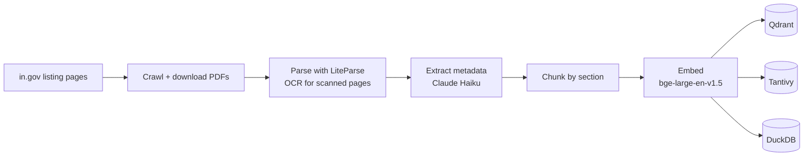

# PAC RAG

Question answering over the Indiana Public Access Counselor's advisory opinions.

Describe a public-records or open-meetings situation in plain language, and PAC RAG finds the past PAC opinions that address it and writes an analysis grounded in them, with a citation for every claim.

> **Not legal advice.** PAC opinions are advisory and persuasive only; they are not binding on agencies or courts. PAC RAG summarizes what the Counselor has said in the past. It does not tell you what the law requires in your situation.

## Contents

- [Background](#background)
- [What it does](#what-it-does)
- [Architecture](#architecture)
- [Requirements](#requirements)
- [Installation](#installation)
- [Configuration](#configuration)
- [Building the index](#building-the-index)
- [Running the app](#running-the-app)
- [API](#api)
- [Evaluation](#evaluation)
- [Development](#development)
- [Project status](#project-status)
- [Acknowledgments](#acknowledgments)
- [License](#license)

## Background

The [Indiana Public Access Counselor](https://www.in.gov/pac/) (PAC) issues advisory opinions on disputes under two statutes:

- the **Access to Public Records Act** (APRA, IC 5-14-3), and
- the **Open Door Law** (ODL, IC 5-14-1.5), which governs public meetings.

The PAC has published thousands of these opinions since 1999, both formal complaints (`FC`) and informal inquiries (`INF`). They're a useful body of interpretation, but they're spread across hundreds of year-by-year listing pages and PDFs, and older ones are scanned images. PAC RAG turns that archive into something you can ask questions of.

A current local build indexes about 5,000 opinions (1999 to the present), split into about 30,000 searchable chunks.

## What it does

**Ask a question.** For example:

- "A city has not responded to my public records request submitted three weeks ago. Is this a violation of APRA?"
- "Can a school board discuss a superintendent's contract in executive session?"
- "Can an agency charge me for the staff time it takes to search for records?"

The answer streams back with citations in the form `(25-FC-118, p. 3)`. The retrieved opinions are listed alongside the answer, and clicking a citation highlights the opinion it came from. If the retrieved opinions don't address the question, the answer says so rather than guessing.

**Browse opinions.** Filter the full catalog by year, agency type, finding (violation, no violation, mixed, and so on), statute area, and issue tag, or search by keyword. Each opinion page shows its extracted metadata, a short summary, the parsed text, and a link to the original PDF.

**Use the API.** Everything the web app does goes through a small FastAPI service, including retrieval on its own with no generated answer.

### How answers stay grounded

- **Hybrid retrieval.** Dense vector search and BM25 keyword search run in parallel. Exact statute citations like `IC 5-14-3-4(b)(8)` match lexically, and paraphrased questions match semantically.
- **Reranking.** A cross-encoder rescores the candidates before anything reaches the language model.
- **Citation checking.** Every citation in a generated answer is checked against the set of chunks that were actually retrieved. A citation to an opinion that wasn't retrieved is flagged.
- **Metadata from the documents.** Agency, finding, counselor, and issue tags are extracted from each opinion and validated against a schema. Redacted complainants stay `null` rather than being guessed.

## Architecture

### Indexing pipeline (offline)



Every stage is idempotent: a DuckDB manifest records what has already been done, so rerunning a stage only processes new or changed opinions.

The opinion ID (for example `25-FC-118`) is the canonical key throughout. It's taken from the listing-page text rather than the PDF filename, because the source filenames are not always accurate.

### Query pipeline (per request)

```
Filter (DuckDB metadata)
  -> Retrieve (Qdrant dense + Tantivy BM25, in parallel)
  -> Reciprocal Rank Fusion
  -> Rerank (bge-reranker-v2-m3)
  -> Generate (Claude Sonnet, with required citations)
```

Filters such as statute area or agency type are inferred from the question. They're treated as suggestions: if applying them leaves too few candidates, retrieval reruns without them and the response notes that the filters were relaxed.

### Components

| Package / app | Role |
|---|---|
| `packages/pac_crawler` | Scrapes the PAC listing pages, downloads PDFs, maintains the manifest. CLI: `pac-crawl` |
| `packages/pac_pipeline` | Parsing, metadata extraction, chunking, embedding, indexing, and retrieval. Owns the shared `Settings`. CLIs: `pac-parse`, `pac-extract`, `pac-embed` |
| `packages/pac_api` | FastAPI service: `/ask`, `/search`, `/opinions`, `/healthz` |
| `packages/pac_eval` | Gold-set evaluation of retrieval and answer quality. CLI: `pac-eval` |
| `apps/web` | Next.js frontend |

```
pac_eval -> pac_api, pac_pipeline
pac_api  -> pac_pipeline, pac_crawler
pac_pipeline -> pac_crawler
```

### Storage

Everything runs embedded on one machine. There are no database servers to operate.

| Store | Contents | Default location |
|---|---|---|
| DuckDB | Opinion manifest, extracted metadata, chunk metadata | `data/catalog/pac.duckdb` |
| Qdrant (embedded) | Chunk vectors, 1024-dim, cosine | `data/qdrant/` |
| Tantivy | BM25 index of chunk text | `data/tantivy/` |
| Filesystem | Original PDFs and parsed JSON | `data/pdfs/`, `data/parsed/` |

### Tech stack

Python 3.12+ (uv workspace), FastAPI, Qdrant, tantivy-py, DuckDB, sentence-transformers, the Anthropic SDK, and structlog. The frontend uses Next.js 16, React 19, shadcn/ui, and Tailwind CSS v4.

## Requirements

- **macOS on Apple Silicon** is the primary target. Embedding and reranking use the GPU through PyTorch's MPS backend and fall back to the CPU elsewhere (slower, but it works).
- [uv](https://docs.astral.sh/uv/) for Python and dependency management
- [just](https://github.com/casey/just) as the command runner
- [Node.js](https://nodejs.org/) and [pnpm](https://pnpm.io/) for the frontend
- [LiteParse](https://github.com/run-llama/liteparse), whose `lit` CLI parses the PDFs
- An [Anthropic API key](https://console.anthropic.com/) for metadata extraction, answer generation, and the eval judge
- Disk space: about 1 GB for the indexed corpus, plus a few GB for the embedding and reranker models

On macOS with Homebrew:

```bash
brew install uv just pnpm
brew install run-llama/liteparse/llamaindex-liteparse
```

## Installation

```bash
git clone https://github.com/justinvasel/pacrag.git
cd pacrag

# Python packages (all workspace members)
just sync

# Frontend
cd apps/web && pnpm install && cd ../..

# Configuration
cp .env.example .env
# then edit .env and set ANTHROPIC_API_KEY

# Download and cache the embedding and reranker models
uv run python scripts/warm_models.py

# Check that the API key works
uv run python scripts/check_anthropic.py
```

`just sync` runs `uv sync --all-packages`. Use it rather than a bare `uv sync`, which installs only the workspace root.

To check the whole stack on a single opinion before building the full index, run `uv run python scripts/smoke_test.py`.

## Configuration

Settings are read from environment variables and from `.env` in the repository root. Only `ANTHROPIC_API_KEY` is required.

| Variable | Default | Purpose |
|---|---|---|
| `ANTHROPIC_API_KEY` | (none) | Anthropic API key. Required for extraction, generation, and evaluation |
| `PAC_DATA_DIR` | `./data` | Root for PDFs and parsed JSON |
| `PAC_DUCKDB_PATH` | `./data/catalog/pac.duckdb` | Catalog database |
| `PAC_QDRANT_PATH` | `./data/qdrant` | Embedded Qdrant storage |
| `PAC_TANTIVY_PATH` | `./data/tantivy` | BM25 index |
| `PAC_MODELS_DIR` | `./data/models` | Hugging Face model cache |
| `PAC_LIT_BINARY` | `lit` | Path to the LiteParse CLI |
| `NEXT_PUBLIC_API_URL` | `http://localhost:8000` | Where the web app sends API requests |

Model choices (embedding model, reranker, and the Claude models used for extraction and generation) are defined in `packages/pac_pipeline/src/pac_pipeline/config.py` and can be overridden with `PAC_`-prefixed variables such as `PAC_GENERATION_MODEL`.

The `data/` directory is gitignored. Everything in it can be rebuilt from the PAC website.

## Building the index

Run the four stages in order. Each one only processes work that hasn't been done yet, so it's safe to interrupt and rerun.

```bash
just crawl     # scrape listing pages and download PDFs
just parse     # extract text, detect sections, OCR scanned pages
just extract   # extract structured metadata with Claude Haiku
just embed     # chunk, embed, and index into Qdrant, Tantivy, and DuckDB
```

A full first build crawls every year since 1999 and calls Claude once per opinion during extraction, so it takes a while and costs some API usage. To try things out on a small slice first:

```bash
just crawl --year 2025 --limit 20
```

Useful flags (run any command with `--help` for the full list):

| Command | Flags |
|---|---|
| `pac-crawl` | `--year YYYY`, `--kind FC\|INF\|all`, `--listing-only`, `--limit N` |
| `pac-parse` | `--year YYYY`, `--opinion-id ID`, `--reparse`, `--lit-binary PATH` |
| `pac-extract` | `--opinion-id ID`, `--limit N`, `--reextract` |
| `pac-embed` | `--opinion-id ID`, `--limit N`, `--reindex` |

All four also accept `--data-dir` / `--db-path` where relevant (these override the environment settings) and `-v` for debug logging. The `just` recipes pass extra arguments through, so `just parse --year 2024` works.

Embedded Qdrant and DuckDB allow only one writer at a time, so stop the API before reindexing.

## Running the app

In two terminals:

```bash
just api   # FastAPI on http://localhost:8000, with auto-reload
just web   # Next.js on http://localhost:3000
```

Open http://localhost:3000. The API loads the embedding and reranker models at startup, so it takes a moment before it starts accepting requests. The API only accepts browser requests from `http://localhost:3000` (CORS); the web app's own `/api/ask` route forwards questions to it.

The web app has four pages:

| Route | Page |
|---|---|
| `/` | Ask a question; the answer streams in beside the retrieved opinions |
| `/opinions` | Browse and filter the catalog |
| `/opinions/[id]` | A single opinion: metadata, summary, parsed text, link to the PDF |
| `/about` | What the system is and isn't, with the advisory disclaimer |

## API

The FastAPI service generates interactive docs at http://localhost:8000/docs.

| Method | Path | Description |
|---|---|---|
| `POST` | `/ask` | Retrieve and generate an answer. Body: `{"question": "...", "filters": {...}}` (`filters` optional). Streams Server-Sent Events |
| `GET` | `/search` | Retrieval only, no generation. Query: `question`, optional `filters` (JSON), `top_k` (1 to 50, default 10) |
| `GET` | `/opinions` | Paginated catalog. Query: `page`, `page_size`, `year_min`, `year_max`, `agency_type`, `finding`, `statute_areas`, `issue_tags`, `q` |
| `GET` | `/opinions/{opinion_id}` | One opinion's metadata, parsed text by section, and PDF URL |
| `GET` | `/healthz` | Liveness, plus index sizes for Qdrant, Tantivy, and DuckDB |

`/ask` sends these events:

- `token`: `{"token": "..."}`, one per chunk of answer text
- `metadata`: the citations found in the answer (each marked valid or not), the retrieved chunks, the applied filters, and whether the filters were relaxed
- `error`: `{"error": "..."}` if generation fails

```bash
curl -N -X POST http://localhost:8000/ask \
  -H 'Content-Type: application/json' \
  -d '{"question": "How quickly must an agency respond to a records request?"}'
```

## Evaluation

`pac_eval` scores retrieval and answer quality against a hand-written gold set (`packages/pac_eval/gold_set.yaml`). Each entry has a question, the opinions that should be retrieved, an ideal answer, and the key facts a good answer must contain.

```bash
just eval                       # full run: retrieval + generation + LLM judge
just eval --skip-generation     # retrieval metrics only (no generation or judge calls)
just eval --limit 5             # first five questions
just eval-diff data/eval/A.parquet data/eval/B.parquet
```

Each run writes a Parquet scorecard to `data/eval/`.

| Metric | Measures |
|---|---|
| Recall@8, Recall@16 | Whether the expected opinions appear in the top results |
| MRR | How high the first relevant result ranks |
| Citation precision | Share of the answer's citations that point to retrieved opinions |
| Fact coverage | Share of key facts present, as judged by Claude |
| Hedging score | Whether the advisory disclaimer is present and the answer avoids overclaiming |

`eval-diff` compares two runs and flags regressions larger than `--threshold` (default 0.01). It's the intended way to A/B test changes to chunking, retrieval, or prompts.

## Development

```bash
just lint     # ruff check + pyright
just format   # ruff format
just test     # pytest across all packages

uv run pytest packages/pac_pipeline -k sanitize   # a subset

cd apps/web && pnpm lint && pnpm typecheck
```

Pre-commit hooks run ruff, ruff-format, and basic file checks; install them with `uv run pre-commit install`. Tests never touch the network: Anthropic, HTTP, and model clients are mocked.

Conventions worth knowing before you change anything:

- **Idempotence.** Every pipeline stage must be safe to rerun. The DuckDB manifest decides what has been done.
- **Typed boundaries.** Data that crosses package boundaries uses frozen Pydantic models, not loose dicts.
- **No invented metadata.** LLM extraction is validated against a schema and retried with the validation error. Fields that can't be determined stay `null`.
- **Citation discipline.** Answers cite as `(opinion_id, p. N)`, and every citation must come from the retrieved set.
- **Logging.** structlog with JSON output in library code. `print()` only in `scripts/`.
- **Dependencies.** Add them with `uv add --package <package-name> <dependency>`, then run `just sync`.

The architecture intentionally avoids LangChain, LlamaIndex, Celery, Redis, Postgres, and Docker.

`CLAUDE.md` holds the working conventions for AI coding assistants. `handoff.md` holds the original project spec, milestones, and a list of known quirks in the source data.

### Repository layout

```
.
├── apps/web/            Next.js frontend
├── packages/
│   ├── pac_crawler/     crawl + download + manifest
│   ├── pac_pipeline/    parse, extract, chunk, embed, retrieve; shared config
│   ├── pac_api/         FastAPI service
│   └── pac_eval/        gold set + scorecards
├── scripts/             model warm-up, API key check, smoke test
├── data/                gitignored: PDFs, parsed text, indexes, eval runs
├── justfile
└── pyproject.toml       uv workspace root, ruff/pyright/pytest config
```

## Project status

The indexing pipeline, retrieval, API, web app, and eval harness are all working locally.

Not built yet:

- a scheduled crawl that picks up newly published opinions automatically;
- deployment configuration: systemd units, a Cloudflare Tunnel, backups.

These are described in `handoff.md` (Milestone 9).

Out of scope for now: a citation graph between opinions, court rulings or statutory text alongside the opinions, and user accounts.

## Acknowledgments

- Opinions come from the [Indiana Public Access Counselor](https://www.in.gov/pac/advisory/). This project is independent and not affiliated with or endorsed by the PAC or the State of Indiana.
- Embeddings by [BAAI/bge-large-en-v1.5](https://huggingface.co/BAAI/bge-large-en-v1.5), reranking by [BAAI/bge-reranker-v2-m3](https://huggingface.co/BAAI/bge-reranker-v2-m3).
- PDF parsing by [LiteParse](https://github.com/run-llama/liteparse).
- Metadata extraction and answers by [Claude](https://www.anthropic.com/claude).

## License

No license has been chosen yet. Until one is added, the default copyright rules apply.
